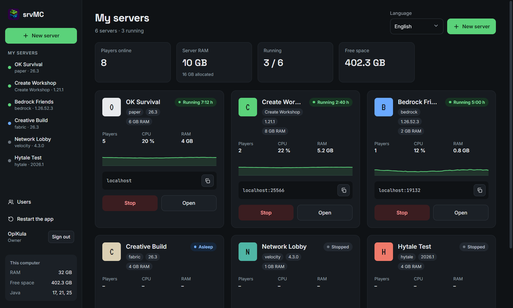
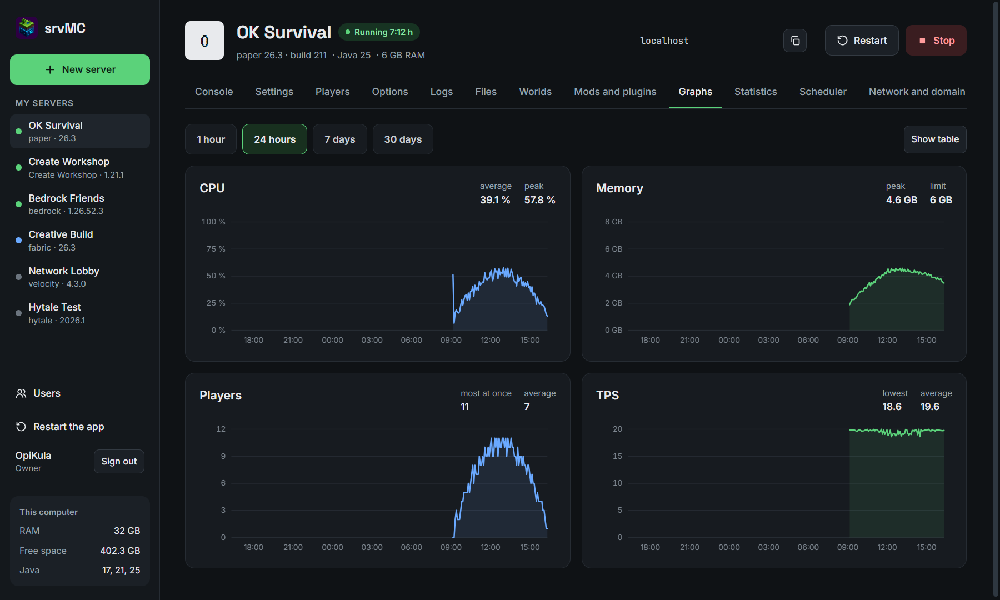
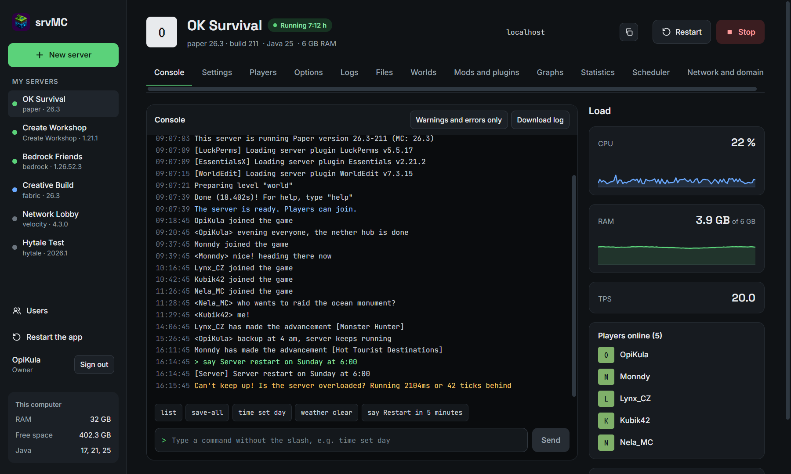
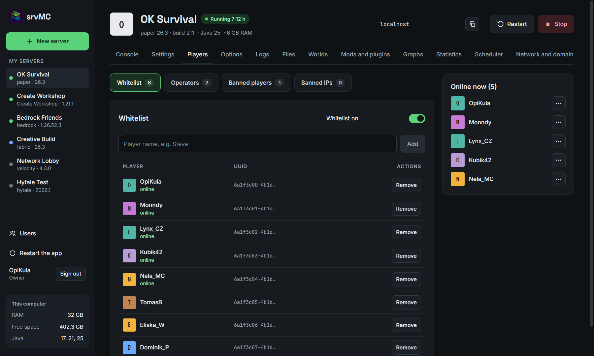
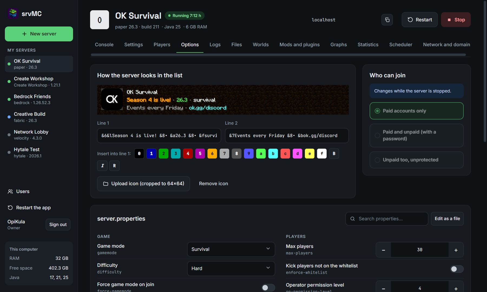
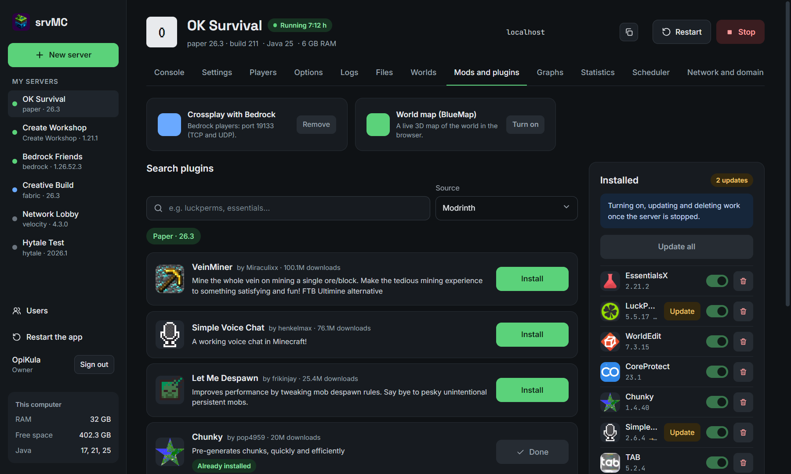
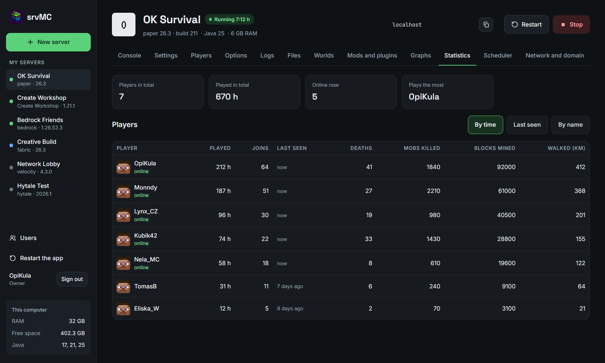
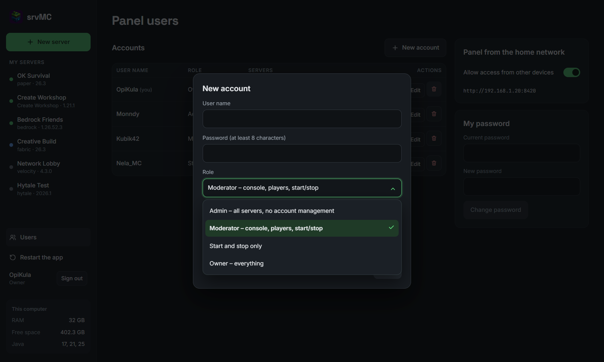
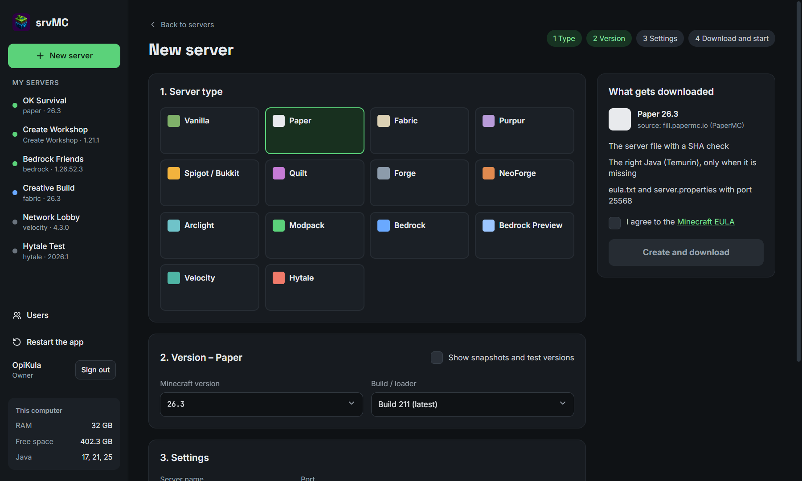
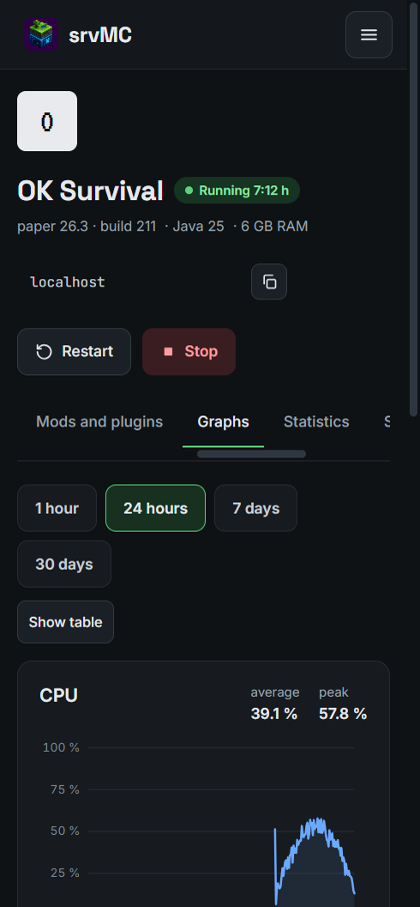

# srvMC

An Aternos-style Minecraft server manager that runs on your own PC (Windows 10/11). Create, start and manage servers in a clean panel. Server files and the right Java download on their own.





















## Download

- **Recommended:** [store.opikula.dev/app/srvmc](https://store.opikula.dev/app/srvmc/)
- **Manually:** download `srvMC-Setup-<version>.exe` from [GitHub Releases](https://github.com/OpiKula2877/srvMC/releases/latest) and run it.

The installer is not signed. When Windows SmartScreen asks, click **More info → Run anyway**. Servers, worlds and backups live in `%USERPROFILE%\srvMC`, and uninstalling does not delete them.

## Contents

**Server types:** Vanilla (snapshots too), Paper, Purpur, Spigot, CraftBukkit, Fabric, Quilt, Forge, NeoForge, Arclight, Velocity, modpacks (Modrinth, CurseForge, Technic), Bedrock, Bedrock Preview and Hytale (experimental).

**Features:**

- Many servers, each with Start, Stop and Restart
- Console with commands and history
- Players: whitelist, operators, bans, kicks
- Options: MOTD editor with colors and a live preview, server icon, every `server.properties` setting
- Search for mods, plugins and modpacks (Modrinth, CurseForge, Hangar, SpigotMC) with one-click updates
- Downloads that a mod author allows only on their website: srvMC opens the page and picks the file up from your Downloads folder
- Paid and unpaid accounts (password login)
- Worlds and backups: upload, download, restore, automatic backups
- Logs and a file manager
- Graphs of CPU, RAM, players and TPS
- Task scheduler, crash watcher with automatic restart, sleep and wake on join
- RAM and disk limits
- Network: UPnP, playit.gg, DuckDNS, your own domain
- Java ↔ Bedrock crossplay (Geyser), BlueMap, Velocity proxy
- Discord notifications, player statistics
- Several panel users with roles
- The panel works on a phone too, and you can install it as an app
- Restart the whole app from the panel (running servers start again on their own)
- English by default, Czech in the language switch on the main page

## For developers

You need Node.js 22+.

```bash
npm install
```

```bash
npm run app
```

```bash
npm test
```

```bash
npm run installer
```

Layout: `packages/backend` (core, Fastify), `packages/web` (panel, React), `packages/shared` (shared types and translations), `apps/desktop` (Electron).

Screenshots come from the panel's demo build with made-up data:

```bash
npm run build:demo -w @srvmc/web
```

```bash
npx electron scripts/screenshots.mjs
```
